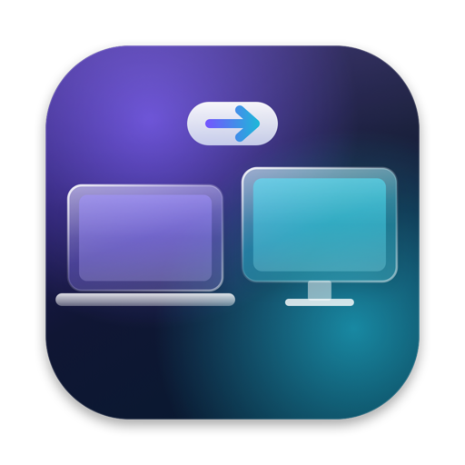
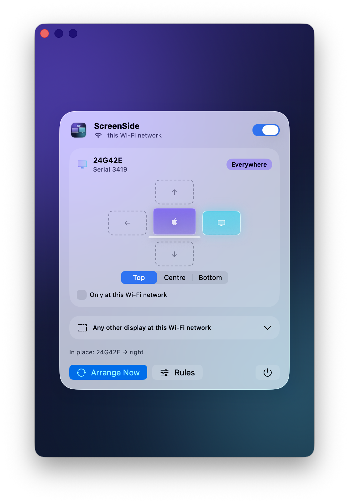
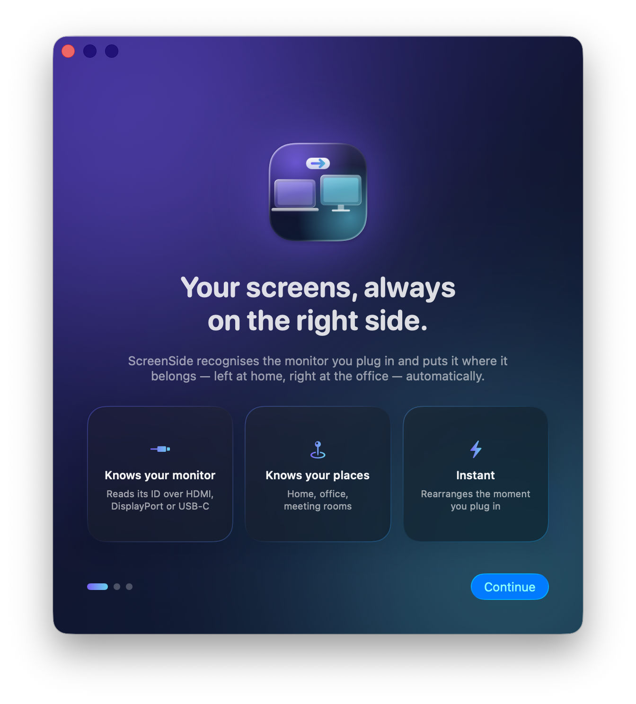
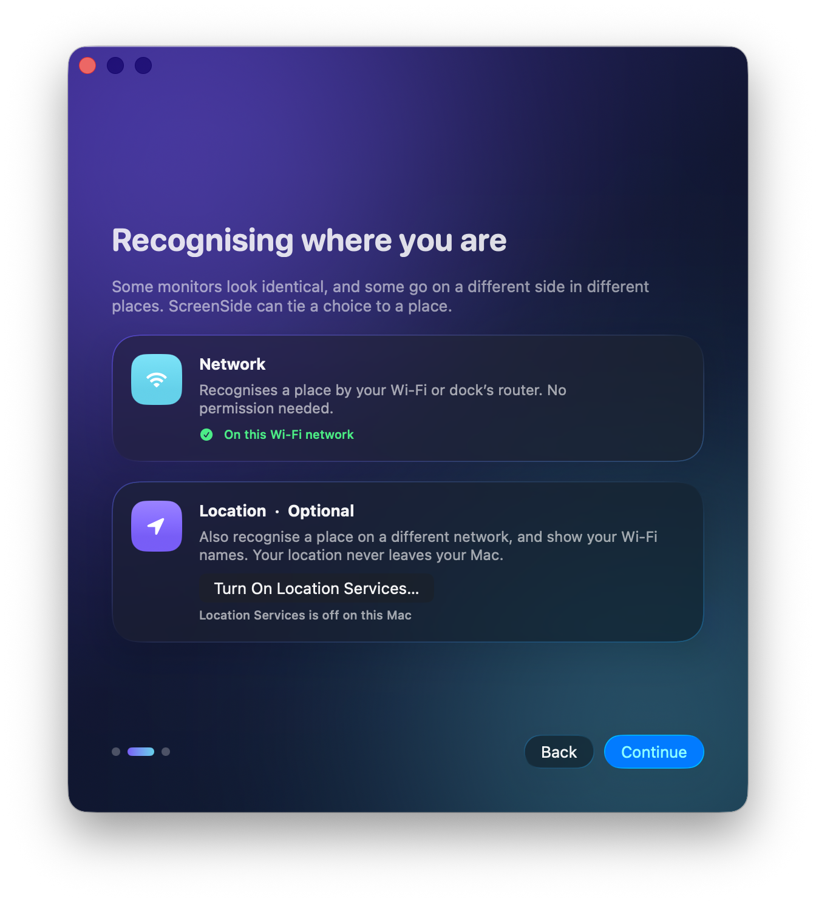
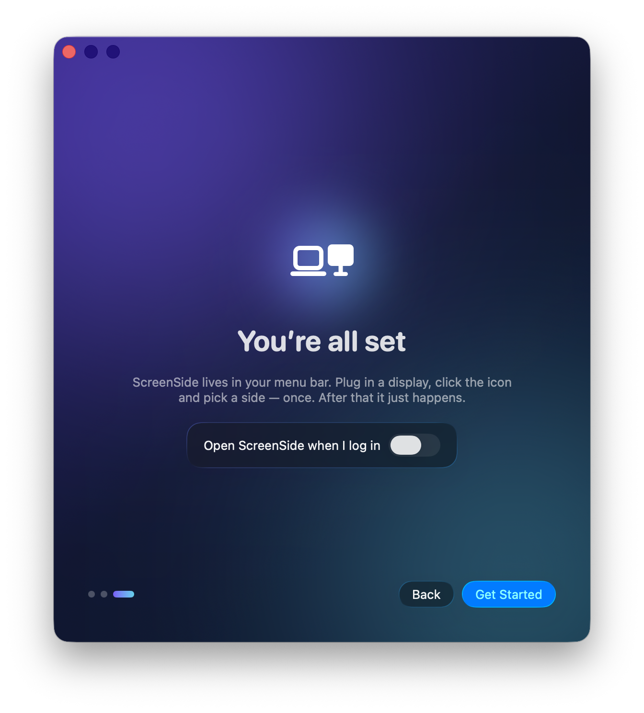
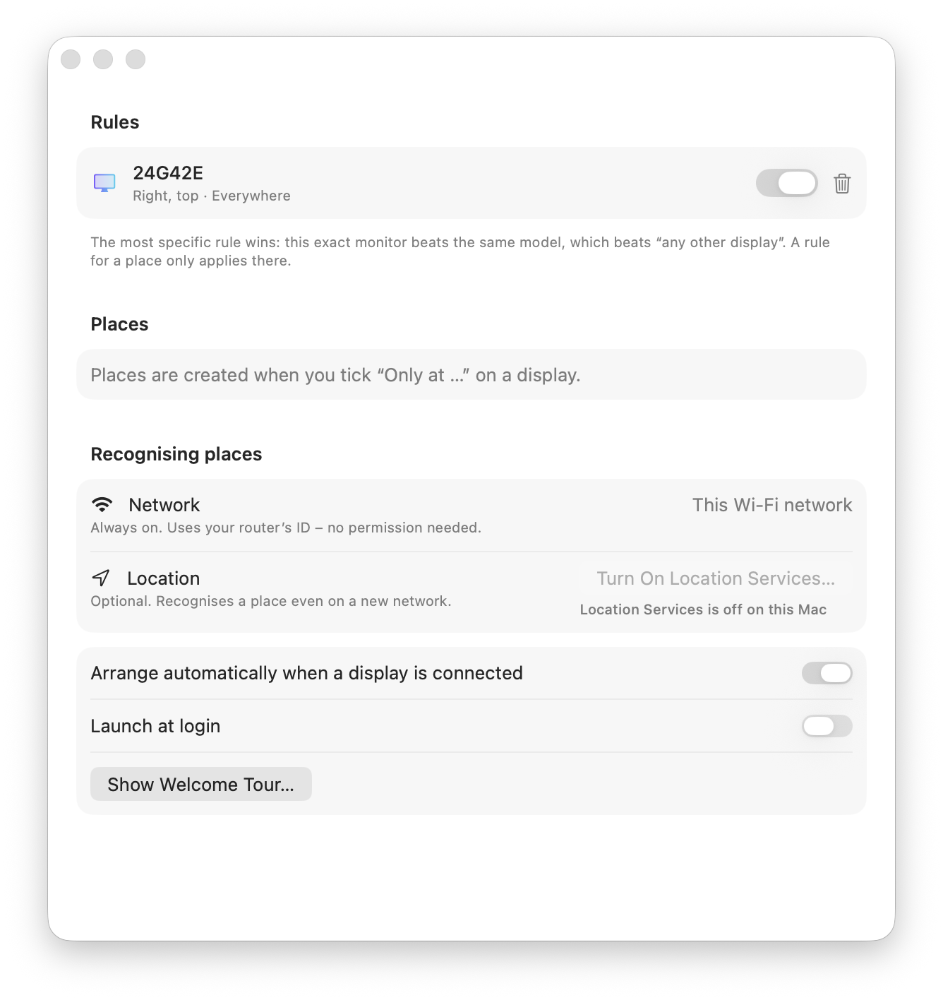

<div align="center">



# ScreenSide

### Your screens, always on the right side.

ScreenSide recognises the monitor you plug in and puts it where it belongs:<br>
left at home, right at the office, above in the meeting room. Automatically.

[**Download for Mac**](https://github.com/AJB93/ScreenSide/releases/latest) · [Website](https://ajb93.github.io/ScreenSide/) · [Build from source](#build-from-source)


<br>



</div>

---

## Why

macOS already saves a layout for each combination of displays it has seen. With one monitor on a direct cable, it usually puts it back where you left it. ScreenSide is for when that isn't enough:

- **The same model of monitor in different places.** If home and office have identical monitors (common with company-issued screens), macOS can't tell them apart and has no idea where you are. It uses whichever layout you saved last.
- **Screens it has never seen.** Meeting rooms and hot desks always get the macOS default, usually on the right.
- **Docks, adapters and forgotten layouts.** Some hubs change how a monitor identifies itself, and arrangements sometimes get lost after updates or sleep.

Pick a side **once** per monitor or per place. From then on, every time you plug in, ScreenSide re-applies your choice.

> **Do you need it?** If you use a single monitor in one place and macOS already gets it right, probably not. ScreenSide earns its place when you move between desks.

## Features

| | |
|---|---|
| 🔌 **Knows your monitor** | Every HDMI, DisplayPort and USB‑C monitor reports its vendor, model and serial number (EDID). ScreenSide remembers each exact unit, even two of the same model. |
| 📍 **Knows your places** | Tie a choice to a place: *left at home, right at the office*. Places are recognised by your Wi‑Fi or dock's router, with **no permission needed**, and optionally by Location Services. |
| 🧭 **Any screen, anywhere** | "Any other display at the office goes above." Great for meeting rooms and hot desks. |
| ⚡️ **Instant** | Re-arranges the moment a display connects or your Mac wakes. No polling, no lag. |
| 🧩 **Multi-monitor aware** | Several screens on one side stack outward. Top / centre / bottom alignment. |
| 🫧 **Liquid Glass** | Native SwiftUI with Liquid Glass on macOS 26 Tahoe, graceful material fallback on macOS 14–15. |
| 🔒 **Private by design** | No analytics, no accounts, no network calls. No Accessibility permission. Your location never leaves your Mac. |

### The most specific rule wins

1. **This exact monitor** (by serial number) at this place
2. **This exact monitor**, anywhere
3. **This model** of monitor (for monitors that don't report a serial)
4. **Any other display** at this place

## Screenshots

<p align="center">
  
  
  
</p>
<p align="center">
  
</p>

## Install

1. Download **ScreenSide.zip** from the [latest release](https://github.com/AJB93/ScreenSide/releases/latest) and unzip it.
2. Drag **ScreenSide.app** into **Applications**.
3. The app isn't notarised yet, so the first time, **right‑click › Open**, or run:

   ```bash
   xattr -dr com.apple.quarantine /Applications/ScreenSide.app
   ```

4. Follow the short welcome tour, then look for the icon in your menu bar.

### Build from source

Requires Xcode 26 (Swift 6) on macOS 14 or later.

```bash
git clone https://github.com/AJB93/ScreenSide.git
cd ScreenSide
./build.sh --install
```

`build.sh` builds a universal (arm64 + x86_64) release, wraps it into `build/ScreenSide.app`, ad‑hoc signs it and zips it. `--install` copies it to `/Applications` and launches it.

## How it works

- **Identifying displays:** `CGDisplayVendorNumber`, `CGDisplayModelNumber` and `CGDisplaySerialNumber` come straight from the monitor's EDID over the cable.
- **Recognising places:** the default gateway's MAC address (via `route` + `arp`) identifies the network without any permission prompt, on Wi‑Fi or Ethernet through a dock. If you allow Location Services, a place can also be matched by coordinates within a radius you set.
- **Arranging:** `CGConfigureDisplayOrigin` inside a display configuration transaction, saved `.permanently` so macOS's own Displays settings agree. The built-in screen is the anchor; the main display (menu bar) always stays at the origin.
- **Triggering:** `NSApplication.didChangeScreenParametersNotification` and wake notifications, debounced while the display finishes negotiating its mode. Your manual tweaks are left alone until the set of connected displays changes.

```
Sources/ScreenSide/
├── Displays.swift          EDID identity + arrangement maths
├── Rules.swift             Rules, places, matching & scoring
├── Network.swift           Router-based network fingerprint
├── LocationProvider.swift  Optional Location Services
├── AppModel.swift          Detection, rule application, onboarding
├── Views.swift             Menu bar panel, arrangement picker, settings
├── Onboarding.swift        Welcome tour & permission explainer
└── Glass.swift             Liquid Glass helpers, brand, menu bar glyph
```

## FAQ

**Doesn't macOS already do this?**
Partly. See [Why](#why). macOS remembers a layout per set of displays, but it can't tell identical monitors apart, doesn't know where you are, and can't handle displays it has never seen.

**My laptop lid is closed. Does it do anything?**
No. With no built-in screen there's nothing to arrange around, so ScreenSide stays out of the way.

**Does it work through docks and USB‑C hubs?**
Yes. Monitors still report their EDID through docks, and a dock's Ethernet port counts as a network for place matching.

**Why is my Wi‑Fi shown as "this Wi‑Fi network"?**
macOS only reveals Wi‑Fi names to apps with Location permission. Network matching works either way; you can rename places in **Rules**.

**Two identical monitors?**
If they report serial numbers (most do), each gets its own rule. If not, use a place-based rule.

## License

[MIT](LICENSE) © 2026 Adam Broadbent
